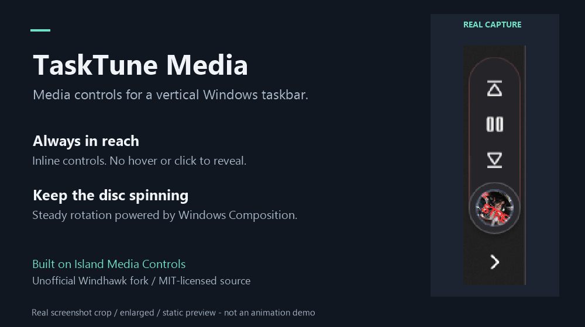

# TaskTune Media

**Always-visible media controls above the system tray on a vertical Windows 11 taskbar.**

TaskTune is an unofficial, MIT-licensed fork of **Island Media Controls 1.0.0 by
[usho](https://github.com/usho-lear)**. It runs as a [Windhawk](https://windhawk.net/)
mod inside Explorer, not as a separate desktop application.

<p align="center">
  
</p>

*Demo: a cropped, enlarged capture of the running widget, with explanatory labels
outside the capture. Unrelated apps, notification badges, clock and desktop are
excluded. This static image does not demonstrate animation.*

## What it changes

- **No click or hover to reveal controls.** In Side expansion mode on a vertical
  taskbar, transport controls remain open even after the pointer leaves.
- **Artwork above the tray.** Controls extend upward by default, with automatic
  sizing to match the existing taskbar thickness.
- **Keep the rotating disc.** Steady rotation uses Windows Composition; the
  inherited finite pause/skip transitions remain.
- **Pause without losing the widget.** Visibility follows the existence of a media
  session, rather than whether it is currently playing.
- **Release space when the session disappears.** The native reservation is removed
  when the hidden inline widget no longer needs it.
- **Avoid pushing the clock off-screen.** Version `1.0.0-tasktune.4` refreshes the
  inline anchor and avoids translating the whole native tray toward a stale one.

Media apps must expose a Windows **GSMTC** session. This is **not** an inventory of
all open browser video tabs. A paused session retained by an app can keep the
widget visible. Upstream fullscreen/environment hiding still applies.

## Requirements and compatibility

- **Windows 11, x64**, with an **already-working vertical taskbar**. TaskTune does
  not create a vertical taskbar, move it, or configure another taskbar mod.
- **Windhawk with its compiler installed.** The fork was built and locally run
  with Windhawk 1.7.3; upstream recommends 2.0+ for its redesigned settings UI.
  Compatibility with every Windhawk/Windows version is not established.
- **Python 3.10+** to build, and **PowerShell 7** for the management scripts.
  The optional media-state probe uses the Windows PowerShell 5.1 included in Windows.
- Administrator approval for installation, disabling through the helper, and
  benchmarking. Building itself does not need to install anything.

The **left vertical primary taskbar** is the locally exercised configuration.
Right-edge behavior is inherited but has not been independently validated here.
The upstream implementation attaches to the primary taskbar only. Test with your
own Windows build, taskbar customization, DPI and auto-hide settings before
relying on it.

> **Explorer safety:** a Windhawk mod runs inside the taskbar process. A defect
> can affect Explorer. Save ongoing work and enable only one taskbar media mod at
> a time. The supplied scripts never automatically kill or restart Explorer.

## Build

Clone or download this repository, open PowerShell in its root, then run:

```powershell
python -I .\tools\build.py --check-only
python -I .\tools\build.py
```

The first command checks the pinned upstream hash, 33 parsed setting defaults,
20 compile-time policy cases and 19 structural regression checks. It still needs
the Windhawk compiler. The second also compiles the DLL and writes
`dist/manifest.json`, including source and DLL hashes. No Python packages or
network downloads are needed by the build script.

For a non-default Windhawk location:

```powershell
python -I .\tools\build.py --windhawk "C:\Path\To\Windhawk"
```

**Building does not install, load or benchmark the mod.** Structural checks are
not GUI tests. Do not run the DLL with `rundll32` or `regsvr32`.

## Fresh installation

The helper is intended for a standard Windhawk installation under Program Files /
ProgramData, not a portable or custom-runtime installation. It refuses to replace
an existing TaskTune installation or a different shared runtime. Do not use its
Install action as an updater.

1. **Exit Windhawk completely** through its tray menu. The installer requires its
   service to be stopped; it will not force-unload mods for you.
2. Build the source as above, then preview installation:

   ```powershell
   pwsh -NoProfile -File .\tools\Manage-Mod.ps1 -Action Install -WhatIf
   ```

3. Install and approve the administrator prompt:

   ```powershell
   pwsh -NoProfile -File .\tools\Manage-Mod.ps1 -Action Install
   ```

4. Open Windhawk, find **TaskTune Media (local fork)** under installed mods, and
   explicitly enable it. It is installed **disabled**; the helper does not start
   Windhawk or load the DLL.

The helper verifies the build manifest and copies matching compiler runtimes only
when needed. If Native Taskbar Media Controller is installed, it also sets that
mod to disabled to prevent both from loading. Other conflicting media mods must
be disabled manually.

### Default preset

| Setting | Value |
| --- | --- |
| Display mode | Side expansion mode |
| Taskbar placement | Tray — far left (above the tray on a vertical taskbar) |
| Material | Solid — the upstream legacy alias of the Mica-like path |
| Hide when no media | On |
| Feedback lighting / elastic feedback | Off |
| Hover scale | 100% |
| Match taskbar thickness | On |
| Artwork rotation | Retained; compositor-driven in vertical inline mode |

### Quick visual check

1. Start supported media in a windowed browser or player. The widget should appear
   above the tray without a hover or click.
2. Move the pointer away: transport controls should remain visible.
3. Pause and resume. Pause should not remove the widget.
4. Close all media sessions. Once the source app releases them, the widget should
   hide and return the reserved space.
5. Check that the tray, clock and date remain visible after layout changes;
   also exercise your DPI, auto-hide and taskbar customization.

## Disable / recovery

Normally disable TaskTune from Windhawk. To persist its disabled flag without
using the Windhawk UI:

```powershell
pwsh -NoProfile -File .\tools\Manage-Mod.ps1 -Action Disable
```

This requests normal unloading through Windhawk; it cannot guarantee recovery
from an Explorer hang. If the taskbar is already frozen, save Explorer-related
work where possible, press **Ctrl+Shift+Esc**, select **Windows Explorer**, and
choose **Restart** yourself. File Explorer windows/operations may be affected.
The saved disabled flag prevents TaskTune from loading again.

## Performance: measure, don't assume

Continuous disc rotation is implemented with a compositor animation rather than
an infinite XAML storyboard in vertical inline mode. This avoids a TaskTune
per-frame UI callback for steady rotation, but **does not establish negligible
CPU, GPU, memory or power use**. Inherited timers and other animations still exist.

Earlier short rotating-build comparisons did not maintain a consistent playback
state, so they are **not valid controlled continuous-playback benchmarks**. There
is no verified "96% saving" or "ultralight" claim for the current rotating build.

An optional monitored ON/OFF/ON test is included:

```powershell
pwsh -NoProfile -File .\tools\Benchmark-Mod.ps1 -Samples 25
```

- Start with TaskTune enabled and Windhawk running. Keep the same media playing
  and minimize other desktop activity; the script never starts or pauses media.
- The test changes the mod's enabled state, checks actual DLL load/unload and
  taskbar responsiveness, and keeps the same Explorer process.
- CPU is normalized across all logical processors. RAM covers the whole process,
  not an isolated widget allocation. DWM includes unrelated desktop work; GPU
  counters are optional, coarse and driver-dependent, not power measurements.
- Playback is checked at phase boundaries, not continuously; content identity is
  not checked. A completed script alone does not prove a valid comparison.
- On success the mod is enabled again. After a toggling failure it persists
  disabled rather than forcing another load or restarting Explorer.

Results stay in `benchmarks/`, which is ignored by Git. **Logs can contain Windows
account names, machine names and local paths; review/redact before sharing.**

## Current validation and limitations

`1.0.0-tasktune.4` passed the build-time checks and was installed through a
monitored unload/reload while preserving settings and the same responding Explorer
process. A post-fix capture shows the date fully visible. Read-only placement
inspection showed no mod-owned translation of the native tray after the fix.

This verifies the observed local correction, **not** long-term stability, every
native reflow or every playback interaction. No new controlled performance result
is claimed for `.4`. See [CHANGELOG.md](CHANGELOG.md) for the fork's changes.

## Repository contents and privacy

- `mods/tasktune-media.wh.cpp` — modified mod source.
- `upstream/island-media-controls.wh.cpp` — byte-preserved pinned baseline.
- `tools/build.py` — reproducible local build and focused regression checks.
- `tools/Manage-Mod.ps1` — fresh-install / disable helper.
- `tools/Benchmark-Mod.ps1`, `tools/Get-MediaState.ps1` — optional local measurements.
- `tools/Capture-Taskbar.ps1`, `tools/Make-Demo.ps1` — optional local capture/crop tools.
- `docs/images/demo.png` — reviewed, cropped demonstration image.

Build outputs, registry backups, transcripts, raw benchmarks, full taskbar
captures, credentials and editor/session state are excluded. Historical one-off
upgrade and experimental diagnostic scripts are intentionally not distributed.
Full taskbar captures may reveal unrelated apps and notifications: keep them local
and crop/review any demonstration before sharing.

## Upstream and license

This is **not an official Island Media Controls or Windhawk release**. Report
TaskTune-specific problems in this repository, not as if they were upstream bugs.

- Original author: **usho**.
- Original project: <https://github.com/usho-lear/island-media-controls>.
- Official mod: <https://windhawk.net/mods/island-media-controls>.
- Pinned source: [ramensoftware/windhawk-mods, commit
  `1aece9a6cf5c3aea1d4fa1081d7b0bedbd1364e4`](https://github.com/ramensoftware/windhawk-mods/blob/1aece9a6cf5c3aea1d4fa1081d7b0bedbd1364e4/mods/island-media-controls.wh.cpp).
- Pinned SHA256: `df92f1962198ae06f277aceebcc43244cc97ae0fb042d5eae2f86e5e130dac9f`.

Source code is provided under the **[MIT license](LICENSE)**. Original metadata
and author attribution are preserved. See [THIRD_PARTY.md](THIRD_PARTY.md) for
provenance and the scope of third-party screenshot content.
